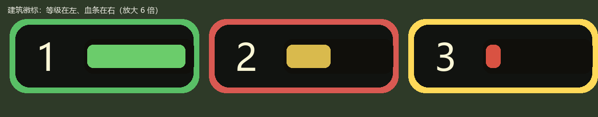

# 城邦争霸首章复刻（Windows x64）

## 范围

- 原版：4399《城邦争霸》正式版 1.0.4。
- 关卡：L1-L8，不包含 L99 教学关。
- 系统：经济、补给、招募、升级、附属建筑、寻路、驻军、远程战斗、特技、四族法术、AI、占领和胜负。
- 局外：简单关卡选择、L1-L8 解锁、最佳星级/时间、本地自动存档。
- 不包含：教令、第二/三章、标题动画、设置、成就大厅和联网。

## 当前实现

- `BattleSimulation` 使用 30 Hz 固定步进，接收统一 `BattleCommand`，输出 `BattleSnapshot` 和 `BattleEvent`。
- 战斗使用原版阵营索引，支持 L4、L5、L7 的双 AI 玩家；每个 AI 独立维护资源、修正器、部队和施法冷却。
- 部队由逐单位状态组成，包含独立位置、HP、攻击计时、目标、士气、经验、冰冻、毒、冲锋和弹道。
- 1.0.4 首章敌方逐关修正器已经接回；玩家应用原版基础教令第一档，完整教令界面与跨章成长仍不在范围内。
- 15 类首章特技已覆盖冲锋、长枪、盾墙、毒、冰冻、溅射、攻城、恐吓、神圣光环、恐怖冲刺、纪律、机械和不朽免疫规则。
- 四族 16 个法术按原版 ID 和效果类别执行，包含单次攻击、0.5 秒旗帜脉冲、召唤、转化、恐惧和终极技能条件。
- 道路用 `Level1-8GraphMarkersClass` 恢复的 303 个中间 waypoint 进行带权寻路。
- 操作：左键按住部队拖动下令，左键单击建筑/空地选中，单击空地取消选择；原版没有框选多选，对应的拖框逻辑已删除；右键不再用于战斗命令。
- `TakeoverLevelSelectUI`、`TakeoverBattleUI`、`TakeoverResultUI` 与 `TakeoverToastUI` 按窗口职责拆分；战斗 HUD、检查器、法术栏、GM 面板和头顶徽标由独立 `UIWidget` 管理，布局来自对应 Prefab。
- 战役进度写入 `Application.persistentDataPath/takeover-campaign.json`，采用临时文件、备份和损坏回退。
- 原版 1.0.4 已实际导入 45 个兵种的三帧循环、7 类建筑的四阵营外观、8 张地图、78 个音频、14 个字体和 765 张原始图片。
- 地图 Sprite 的完整导出边界先居中裁切为原版 `BitmapData` 的 800×600 舞台，再叠加节点；模拟坐标、地图像素坐标和 Unity 显示坐标分别转换，保留 Flash 的 Y 轴方向。

## 原版资源结果

- SWF：20,934,803 字节，SHA-256 `b9640da8118cf924d87a759834a39197db62c3273b4aeeef4eb5f990d37a1463`。
- FFDec 26.4.0 导出 1,437 个 ActionScript、765 张图片、23,074 个精灵帧、78 个声音、14 个字体和 SymbolClass 映射。
- 原版素材已通过 YooAsset 的 Actor、Scenes、Audios、Fonts、UIRaw 收集器导入，Play Mode 中地图、单位、建筑、字体和音乐 location 均有效。
- 当前单位动画采用每个兵种三段代表性 `Go` 帧循环；完整攻击/待机/死亡时间线仍可按反编译 Sprite 时间线继续细化。

## 外部 Windows 构建

本机按约定没有安装 Unity Windows Build Support。以下工作仍需在已有该模块的 Windows/CI 环境执行：

- Luban 重新生成到 Windows 构建缓存。
- Unity Windows x64 Player 构建、符号归档和 Windows 真机验收。
- 用 Windows 成品逐关对照原版反编译行为，校正视觉动画帧和不可自动断言的时序细节。

外部流程见 `Tools/TakeoverPipeline/README.md`。

## 验证

Unity 编辑器中执行 `TEngine/Takeover/运行首章规则校验`，或批处理：

```powershell
Unity.exe -batchmode -nographics -quit `
  -projectPath <repo>\UnityProject `
  -executeMethod TakeoverValidation.RunBatch
```

校验覆盖配置行数、L1-L8 节点和道路 waypoint、八关初始化、多 AI 玩家、收入边界、逐单位战斗、占领、特技解析、16 个法术入口、敌方修正器，以及四个窗口 Prefab 的 Canvas/CanvasScaler/GraphicRaycaster、必需 Widget 节点、按钮组件和所有 UI Prefab 的问号占位符。

既有验证记录（UI 拆分前）：

- Unity 全量脚本编译与首章规则校验：此前通过。
- Play Mode 冒烟：旧合并窗口、L1 启动和模拟推进此前通过。
- 原版资源冒烟：地图图集、兵种动画、建筑外观、原版字体与 WAV 音乐均成功加载，无缺失 location。
- 提示消息由独立 `TakeoverToastUI` 深色浮层显示；战斗 HUD 背景不接收鼠标事件，不遮挡地图操作。
- L1-L8 固定种子压力扫描：八关均完成初始化并运行到终局或 900 秒上限，无异常；该脚本玩家只用于发现死锁和异常，不代表玩家真实通关能力。

本次 UI 拆分后的 Unity 编译、`TakeoverValidation.RunBatch` 和 `TakeoverValidation.RunPlaySmoke` 尚待重新运行；上述旧窗口验证结果不代表新窗口已通过运行验证。

## UI 文案问号占位符修复

预制体原先由非 UTF-8 的文本通道写入，静态中文曾退化成 `?`（运行时由 C# 赋值的文案正常，所以表现为“部分中文正常、静态文案全是问号”）。选关、战斗、结算、提示已拆分为各自的 Prefab，静态文案按下表保留：

| Prefab / 节点 | 文案 |
|---------------|------|
| `TakeoverLevelSelectUI` / `m_text_Title`, `m_text_Hint`, `m_btn_ResetSave/m_text_Label` | 第一章 · 西利亚公国 / 点击关卡开始 · 通关后解锁下一关 / 清除进度 |
| `TakeoverBattleUI` / `m_btn_Pause`, `m_btn_Restart`, `m_btn_Levels` | 暂停 / 重开 / 关卡 |
| `TakeoverBattleUI` / `m_btn_GmGold`, `m_btn_GmMana`, `m_btn_GmSpeed1|2|4|8` | 金币 +1000 / 法力 +500 / ×1 / ×2 / ×4 / ×8 |
| `TakeoverResultUI` / `m_btn_Replay`, `m_btn_Next`, `m_btn_Menu` | 再来一局 / 下一关 / 选关 |
| `TakeoverUIActionButton` / `m_text_Label` | 选项 |

`TakeoverValidation` 检查所有 UI Prefab 中的 Text 是否残留 `?`，并校验窗口 CanvasScaler 与关键节点/组件。本次拆分后的 Unity 编译、静态校验和 Play Mode 表现仍待复验。

## 建筑贴图的红色底座与蓝色字母

`NodeTown / NodeCastle / NodeCamp / NodeMageTower` 四个 SWF 符号的第 0 帧里，除了建筑本体还有两块“作者态”元素被 FFDec 一起烤进了位图：

- 一块纯红 `#FF0000` 的底座/旗帜占位图（原版运行时由脚本染色）；
- 蓝色 `#0000FF` 的类型字母（`T` / `C` / `TOWE`）。

因此 `takeover_building_1..4_{green,red,blue,purple}` 在游戏里会显示成“建筑正面压着一块大红板 + 几个蓝字母”。注意四个阵营变体的红板位置、像素数完全一致（约 1600 像素），说明它不是阵营色，而是未染色的占位色。

处理方式见 [`clean_building_baseplates.py`](../Tools/TakeoverPipeline/clean_building_baseplates.py)：

- 红色底座（含 3px 抗锯齿描边）→ 用该贴图外圈干净像素的中值色平涂并加轻微明暗渐变；
- 蓝色字母（含 2px 描边）→ 同行左右最近干净像素填色，左右都够不到（悬空）则挖成透明；
- 只处理 `takeover_building_1..4` 的 20 张主贴图；`_f0/_f1/_f2` 帧代码未使用，保持原样；`5..7`（农场/矿/方尖碑）本身没有底座，未改动。


**注意这是 retouch 而不是还原**：底座是不透明地盖在建筑本体上的，导出的 PNG 里底座下面没有像素，所以那块区域看起来是一段实心墙体，而不是原版的建筑内部。要做到完全还原，只能用原始 SWF 重新挑帧（隐藏底座/字母的帧）再跑管线。

## 建筑贴图配置到 building.xlsx（默认底图 + 阵营染色）

建筑贴图不再由代码拼名字（原来拼 `takeover_building_{id}_{green|red|blue|purple}`，缺失时再回退到 `takeover_building_{id}`、`takeover_building_town/castle/...`）。现在：

- `Configs/GameConfig/Datas/building.xlsx` 追加一列 `sprite`（`string`，分组 `c`），存建筑默认贴图的 location（YooAsset 地址 = 文件名，不带扩展名）；
- 代码只读表：`TakeoverVisualCatalog.BuildingLocation(id) => Cfg.BuildingById(id)?.Sprite`；
- 四个阵营共用这一张底图，**国家差异靠颜色叠加**：`TakeoverRunner.FactionTint(node)` 用 `Color.Lerp(Color.white, NodeColor(node), FactionTintBlend)` 给 `SpriteRenderer.color` 染色，`FactionTintBlend = 0.55f`（0 = 原图，1 = 纯阵营色）。

| id | 建筑 | sprite |
|---|---|---|
| 1 | 城镇 TOWN | `takeover_building_1` |
| 2 | 要塞 CASTLE | `takeover_building_2` |
| 3 | 营地 CAMP | `takeover_building_3` |
| 4 | 魔法塔 MAGIC TOWER | `takeover_building_4` |
| 5 | 农场 FARM | `takeover_building_5` |
| 6 | 矿场 MINE | `takeover_building_6` |
| 7 | 英雄碑 OBELISK | `takeover_building_7` |

列留空 = 该建筑不显示贴图，`TakeoverSelfCheck` 会把它判为校验失败。仓库里原有的 `takeover_building_{id}_{color}.png`（4 套阵营图）保留作素材，代码已不再引用。

同一张 `takeover_building_2`（要塞）在 `FactionTintBlend = 0.55` 下的四种阵营观感（西利亚 / 卡若米森 / 艾斯得雷 / 瑞维迪斯）：


染色走 `SpriteRenderer.color` 的乘法叠色，会连带压暗；强度固定在 `TakeoverRunner.FactionTintBlend`（0 = 原图，1 = 纯阵营色）。以后若觉得偏暗，可以改成按通道混合，或换成半透明色块叠加。

**导表**：只导数据，不生成代码。

```powershell
Configs\GameConfig\gen_data_only.bat
```

- 该脚本用 `dotnet Luban.dll -t client -d bin --conf luban.conf`，把 `*.bytes` 直接写回 `UnityProject/Assets/AssetRaw/Configs/bytes/`；
- 仓库 `Tools/Luban/` 被 `.gitignore` 忽略，需要自备一份 Luban（或设 `LUBAN_DLL` 环境变量）；本机用的是同机另一项目的 Luban 1.0.0，其编译目标是 net7，脚本里已设 `DOTNET_ROLL_FORWARD=Major` 以便在 .NET 10 上运行；
- 生成代码模板与仓库现有代码**不同版**（新版会写扁平文件名 `takeover.Building.cs`、列表长度加 `Min(_buf.ReadSize(), _buf.Size)`），因此**刻意不跑** `gen_code_bin_to_project.bat`；`GameConfig/takeover/Building.cs` 只按表结构追加了 `Sprite` 字段与读取行。以后若要整体重导代码，需要先决定是否接受模板升级。

## 拖拽下令预览曲线的起点修复

`TakeoverRunner.UpdateOrderPreview(from, to, attack)` 内部已经做了 `DisplayPosition`（逻辑坐标 → 显示坐标）转换，但 `HandleInput` 的两处调用又先把 `_dragSquad.Pos` 转了一次，等于起点被转换两次。

`LogicalToDisplay(y) = 600 - y/2`，二次转换后 `y'' = 300 + y/4`，偏差 `y'' - y = 0.75y - 300`：除了 `y = 400` 这个不动点，其余位置起点都会偏移（逻辑 y 越小偏得越多，最大约 300 逻辑单位），所以曲线经常从地图上某个莫名其妙的位置画出来。目标点的传参（节点 `Pos` 或 `MouseWorldPosition()`）本来就是逻辑坐标，只有一次转换，因此端点是对的。

修复：两处调用改为传 `_dragSquad.Pos`（逻辑坐标），并在方法上注明参数是逻辑坐标。

## 检查器按钮闪烁修复

旧实现把“金币/补给的整数值”也算进检查器刷新键，而收入按逻辑秒入账（`BattleSim.TickLogicalSecond`），导致按钮频繁销毁和重建。当前 `TakeoverInspectorWidget` 通过 `TakeoverActionListWidget` 比较动作结构签名：只有目标、文案或布局变化时才异步创建/回收 `TakeoverActionButtonWidget`；普通状态刷新只更新可交互状态，避免旧、新按钮重叠和无意义的 GC。

结构和状态分开处理：

- `TakeoverInspectorWidget` / `TakeoverSpellBarWidget` 每次刷新都生成按钮计划；`TakeoverActionListWidget` 根据名字、文案、位置、尺寸、字体和上下文生成结构签名；
- 签名变化时先隐藏旧按钮，再通过 TEngine 的 `CreateWidgetByPathAsync` 创建新项、回收多余项；签名不变时只更新按钮的 `interactable`；
- 法术栏也复用同一机制，法力/终极充能变化不会反复重建按钮。

以上实现需在本次 UI 拆分后的 Unity Play Mode 中复验。

## 提示条背景自适应

预制体里 `ToastPanel` 是固定 `700×52` 的深色底（`Image` 颜色 `rgba(0.02,0.025,0.02,0.88)`），短提示（如“选中 057，等级 0”）会把整条 700 宽的底色铺在屏幕下方，横向压住左下角 GM 按钮和底部操作栏。

现由 `TakeoverToastUI.FitToastToText()` 在显示提示时执行：

- 先按“不换行”量 `_toast.preferredWidth`，面板宽度 = `clamp(文字宽 + 40, 220, 700)`；
- 只有文字超过 700 才切回 `HorizontalWrapMode.Wrap`，并按最终宽度重算高度 `clamp(文字高 + 14, 34, 120)`；
- 面板 pivot 是 `(0.5, 0)`、锚点在底部中间，所以缩放只影响自身，不会跑位。

预制体的默认 `700×52` 保留（编辑器里预览用），运行时每次显示提示都会按文字重算。

## GM 面板（可折叠）

左下角的 GM 工具改为可折叠面板，固定层级位于 `TakeoverBattleUI.prefab` 的 `m_item_BattleHud/m_item_GmPanel`：

- **折叠/展开按钮与内容**：均在 Prefab 中固定布局，由 `TakeoverGmPanelWidget` 绑定并控制显隐；展开区域覆盖左半屏，背景完全透明且不拦截射线，空白处照常能点地图；
- **默认折叠**：Widget 创建时以及每次进入/重开战斗都会折叠；
- **内容**：标题「GM 面板」、`金币 +1000`、`法力 +500`、`×1/×2/×4/×8` 调速、**胜利**、**失败**，以及一行说明。布局使用窗口 Prefab 的 800×600 参考分辨率。

新增的两个 GM 按钮走 `TakeoverRunner.GmEndBattle(bool victory)`：直接置 `State.IsOver/HumanVictory`，复用 `Update` 里既有的 `IsOver` 结算分支——「胜利」按当前用时算星并调用 `Campaign.Complete`（解锁下一关），「失败」只出战败结算、不解锁。

面板布局和控件都保存在 Prefab 中；运行时代码只负责绑定事件、切换折叠状态和回调 Runner。

布局示意（画布参考 800×600；面板背景透明，按钮和文字直接浮在地图上，面板本身画在所有 HUD 之上）：


## 地图贴图与舞台坐标的对齐

`takeover_map_{level}.png` 是从 FFDec 导出的 `Level{N}GraphMarkersClass` 帧位图里**居中裁切**出 800×600 的（`import_chapter_assets.py` 的 `crop_rgba_png`），而节点/道路用的是舞台坐标，两者的差值在每张图上都不一样（裁切偏移 L1 是 `246,145`、L8 是 `93,83`），于是建筑看起来“压不到地形上”。

修正量是拟合出来的，不是猜的：`OriginalMapWaypoints` 里有 300+ 个道路 waypoint（舞台坐标，`y` 存的是模拟坐标所以要 `/2` 才是像素），把它们和图上画出来的沙土路对齐，用距离变换搜索平移量，使 waypoint 到最近路面像素的平均距离最小。结果（L3 为例残差 1.9px，L8 本来就是 0）：

| 关卡 | 1 | 2 | 3 | 4 | 5 | 6 | 7 | 8 |
|---|---|---|---|---|---|---|---|---|
| offset x | -46 | -55 | -36 | -22 | -57 | -9 | +3 | 0 |
| offset y | -40 | -42 | -50 | -23 | -65 | -50 | -78 | 0 |

存储与使用：

- `level.xlsx` 新增 `map_offset_x` / `map_offset_y`（`int`、分组 `c`），按 `asset_id` 1..8 填写，其余关卡为 0；
- `TakeoverVisualCatalog.MapOffset(levelAssetId)` 读表返回 `(MapOffsetX, MapOffsetY)`；
- `TakeoverRunner.BuildMapBackground()` 把地图渲染器摆到 `(400 - offset.x, 300 + offset.y)`——因为贴图特征在像素 `(x+ox, y+oy)`，而世界坐标 `y = 600 - y_pixel`，所以 x 取反、y 同号；
- 节点、道路线、迷雾等仍然直接用舞台坐标，不动。


绿点是道路 waypoint，红圈是建筑节点：修复前（左）明显整体偏右下，修复后（右）压在沙土路和空地上。

## 检查器动作按钮（上移 + 可点击状态配色）

原来的招募/建造/升级按钮是从 `Inspector/Actions` 容器的**中心**往下排（第一个在 `-34`，间距 40），实际落点比正文低了约 140px，5 个按钮会垂到面板外面压住地图。

现在改成从容器顶部往下排：`InspectorActionTopY = 90f`、`InspectorActionSpacing = 38f`（[TakeoverInspectorWidget.cs](UnityProject/Assets/GameScripts/HotFix/GameLogic/Takeover/UIPanel/TakeoverInspectorWidget.cs) 顶部常量），第一个按钮紧贴正文下方，5 个按钮仍落在 220 高的 `m_rect_Actions` 容器内。

配色走 `Selectable` 的 ColorTint：

- 可点击：正常 `rgba(0.20,0.48,0.26)`（绿）、悬停更亮、按下更深；
- 不可点击：`rgba(0.30,0.30,0.30)`（灰）。

实现由 `TakeoverActionButtonWidget.ApplyStateColors()` 设置 `button.colors`（ColorBlock），只对检查器按钮生效；法术栏按钮保持 Prefab 默认色，GM 按钮使用固定样式。按钮显示前先套好配色，避免首帧闪出模板默认色。

**踩过的坑**：`ColorTint` 不是直接给按钮上色，而是把状态色写进 `CanvasRenderer` 的颜色，再和 `Image.color` 相乘。按钮模板底图是深色 `rgba(0.15,0.2,0.16,0.84)`，直接叠绿色会变成墨绿。`ApplyStateColors()` 会把 `targetGraphic.color` 刷成白色，状态色才是最终显示色。


面板高度也改成按内容收缩（`InspectorInfoOnlyHeight = 134f`；有按钮时 `InspectorActionBaseHeight = 174f + (按钮数-1) × 38`）：选中部队时只有标题+正文，不再留整块 356 高的空底板；选中自己的城堡/空地时随按钮数量增高。面板锚点在右上、pivot 也是 `(1,1)`，高度变化只影响底部边缘。


## 建筑头顶徽标

`TakeoverBattleUI.prefab` 里的 `m_item_BuildingBadgePrototype`（挂在 `m_rect_SquadBadgeLayer` 下），每个有建筑的节点运行时复制一份：

- 底板：`Ring` 66×26（阵营色边框）+ `Inside` 62×22（深色内衬）；
- **等级在左**：`Level` 24×20 @(-20,0)，13px 居中，显示 `BuildingState.Level + 1`（模拟器里 `Level` 是 0 基的升级次数，界面上是 1..3 级）；
- **血条在右**：`HpBack` 38×12 @(12,0) 深色底 + `HpFill` 36×8 @(12,0)（`Image` = Filled / Horizontal），按 `Hp/MaxHp` 从左往右填充，>60% 绿、>30% 黄、其余红；
- 位置：`DisplayPosition(node.Pos) + (0, 42)`，选中放大 1.12 倍，`ShowBuildingBadges` 可整体关掉。

之前等级显示 0 是因为直接把 0 基的 `Level` 写进了文本；检查器面板里的「等级 x/2」也一并改成「x/3」。



## AI 行为优化与 256 倍速

### 调速

右上角按钮改成 **×1 / ×4 / ×16 / ×64 / ×256**（`m_btn_Speed1/4/16/64/256`，容器 200×38），`TakeoverRunner.MaxSpeed` 提到 256；GM 面板仍是 1/2/4/8/16/32/64 七档。

> ×256 时每帧模拟量是 `min(0.1, deltaTime) × 256`，固定步进会在一帧里跑几百个 tick，帧率会明显下降；只是调试用途。

**为什么之前 ×64 和 ×256 没区别**：`BattleSimulation.Tick` 里有两道硬上限——累计时间 `Mathf.Min(realDeltaSeconds, 0.25f)`、单帧最多 20 个固定步。于是无论请求多少倍速，一帧最多推进 0.25 秒，60fps 下实际只有 **≈15 倍**，×64/×256 全都撞在这条天花板上（20fps 时更惨，≈4.7 倍）。
现在改成按预算算步数：`budget = Mathf.Min(realDeltaSeconds, 40f)`，`maxSteps = ceil(budget / FixedStep) + 2`（硬上限 1500 步），撞上限时清空累加器。60fps 下各档实测推进：×1→1、×4→4、×16→16、×64→64、×256→256（模拟时间/真实时间）。

### AI（`BattleAiSystem`）

`TickAiSecond` 现在按「经济 → 造兵 → 升级 → 指挥 → 法术」跑：

| 步骤 | 之前 | 现在 |
|---|---|---|
| 造兵 | 只在 `FreeSupply > 0` 时买 **1 个随机**兵种 | 每拍最多连续买 **4 个**；按 `战斗力/价格`（输出、血量、射程、Tier）打分，取最优兵种；优先放在**离敌方最近**的据点，买完直接下令推向前线 |
| 经济 | 固定补农场/矿场/英雄碑 | 同上，但用 `ActiveBuildings` 做下限保护，避免 0 建筑时除零式误判 |
| 升级 | 从不升级 | 有余钱（`cost + 250` 缓冲）时升级**威胁最高**的关键建筑，最高 2 级 |
| 指挥 | 只把「守军数量 > Catch」的驻军一个一个派去最近敌节点，兵力永远分散 | 先看有没有据点被围攻（`BuildingThreat > 40`）→ 调最近闲置部队回防；然后集中可用部队：总战力 ≥ **250**（或有 2 支以上且 ≥ 150）就全体压向最薄弱敌方关键建筑；仍不够时，只要抽走多余驻军后能达到阈值，就把**每个据点只留 1 支**、其余也拉去进攻；实在不够才退到前线据点集合。每拍最多暴兵 **6 个** |
| 法术/终极 | 维持 | 维持（`CastAiSpells` / `TryAiUltimate` 逻辑不变） |

战力估算 `SquadPower = 存活人数 × (每兵血量 × 0.15 + 平均伤害 × 1.5 + 射程 × 0.2)`，人类托管和敌方 AI 共用同一套逻辑。

对应效果：GM 加金币后 AI 会连续暴兵、升级前线建筑、把兵力集中成一个拳头打最薄弱的据点，而不是一个兵一个兵往敌人堆里送。

### 为什么「无限金币」也打不过第 8 关

金币不是瓶颈，**补给才是**：

- `PlayerState.SupplyCap` 是「所有己方建筑 `supply` 之和」：城镇 +1、要塞 +2、魔法塔 +1、**农场 +1**（建造成本 150）；
- `SupplyUsed` 是「所有存活部队 `upkeep` 之和」，`CanBuy` 里一旦 `FreeSupply < unit.Upkeep` 就直接拒绝——所以金币再多也买不了兵；
- 而农场只能建在**己方控制的 `loc` 区段**里的可建造点。L8 全图只有 12 个可建造点，分布在 loc 0/2/5/7 四个区段，必须先打下对应要塞/城镇才行。

旧 AI 的问题正好卡在这里：

1. 只在 `FreeSupply <= 0` 时造 **1 个**农场/逻辑秒 → 军队规模很早就封顶；
2. 新兵买完直接 `FindNearestHostileNode` 冲向敌人 → 一支一支送；
3. 进攻判定只看自己战力 ≥ 250，从不看目标守军有多少；
4. 不会为了「多几个可建造点」去打某个区段。

而 L8 的敌方是帝国 + **8 个修正器**，单方但属性强，添油战术必输。

### 对应修复（`BattleAiSystem`）

| 问题 | 修复 |
|---|---|
| 农场造得太少 | `FreeSupply < 4` 就继续造，每拍最多 2 个（金币无限时能迅速把补给铺满） |
| 新兵送死 | 买完先派到**集结地**（离攻击目标最近的己方据点），不再单独冲锋 |
| 不看守军强弱 | 进攻阈值改为 `max(250, 目标守军战力 × 1.25)`，守军强就先攒兵；抽驻军时每个据点只留 1 支 |
| 不抢可建造点 | 补给吃紧（`FreeSupply <= 1`）时，目标评分会给「该 `loc` 区段还有空可建造点」的据点加权 |

### 为什么「还剩一个城堡却不去打」

两个原因叠在一起：

1. **驻军把部队钉光了**。`BattleCombatSystem.FinishMove` 在部队到达己方据点时会把 `HomeNode` 改成该据点，而 `BattleAiSystem.OnGarrisonDuty` 原来按「每个关键建筑留 1 支」判定，占的地盘越多、被钉住的部队就越多；到收尾阶段 8 个据点能钉住 8 支部队，`available` 直接空掉，进攻判定永远不过。
2. **进攻阈值只看绝对战力**。`threshold = max(250, 守军战力 × 1.25)`，最后一个城堡如果堆了敌军主力，阈值会被抬得很高，而 AI 的补给上限又限制了总兵力，于是「围而不打」。

修复（`BattleAiSystem`）：

- 驻军只在**真的被威胁**（`BuildingThreat > 40`）的据点保留，且**全局最多 2 支**（`MaxGarrisonSquads`），不再按据点数量线性增加；
- 收尾阶段（敌方剩余关键建筑 ≤ 2）**不再保留驻军**，并且进攻阈值 ×0.5，所有闲置部队一起压上去；
- 原有的「抽驻军补进攻」逻辑保留：抽完能达到阈值就一起上。

### 为什么「还剩一个城堡却不去打」（第二层原因）

除了驻军把部队钉死，还有两个和**接收机制**相关的问题：

1. `PickAttackTarget` 原来只考虑 `Building.IsActive`（`Hp > 0`）的敌方建筑。城堡被打到 `Hp <= 0` 后只是「待接收」状态，`Owner` 仍是敌方、`CheckEnd` 判定为「未全占」，但 AI 已经**不把它当目标**了 —— 于是永远围着不打，游戏也结束不了。
2. 接收判定在 `BattleCombatSystem.TickSquads` 里用 `距离 <= 42`，而 `FinishMove` 让部队在 `<= 70` 就算到位。远程/攻城部队停在射程外（或阵型展开到 42~70 之间）时**站在旁边永远接收不了**。

修复：

- `PickAttackTarget` 不再过滤 `Hp <= 0` 的建筑，并给它们 **+100 分**（离得最近的空血建筑优先）；
- `CommandArmy` 遇到空血建筑时**不需要凑战力**，随便派一支空闲部队（连驻军都行）过去接收；
- 接收半径从 **42 改成 70**，和 `FinishMove` 的到位判定对齐。

### 重开重置倍速

`TakeoverRunner.StartLevel`（「重开」按钮和关卡选择都会走这里）开头现在把 `_speed` 重置为 `1f`，所以每次重开都是 ×1 起手，HUD 的高亮会跟着 `RefreshHud` 自动回到 `×1*`。

## AI 托管开关（底栏）

底栏 `m_btn_Settings` 右侧新增 `m_btn_AiToggle`（30×30，标签 `AI`），点击切换「玩家是否交给 AI 托管」：

- `PlayerState.AiControlled` 为 true 时，`BattleSim` 的 AI 心跳条件从 `AiEnabled && !IsHuman` 放宽为 `AiEnabled && (!IsHuman || AiControlled)`，于是 AI 会替玩家建造、买兵、施法、出征；
- `TakeoverRunner.ToggleHumanAi()` 切换并播报「AI 已接管我方 / 已收回 AI，恢复手动操作」；
- 底栏按钮标签显示 `AI*`、底色变绿表示托管中，`RefreshHud` 每帧同步状态；
- 玩家手动操作不会被禁用，托管期间两边同时下命令，随时点一下按钮收回。

`TakeoverValidation` 里补了 `m_btn_AiToggle` 与其 Label 的路径校验。

## 法术播报与表现

`SpellCast` / `UltimateCast` 事件由 `BattleSpellSystem.TryCastSpell` 在施法成功后抛出，现在带三样信息：

- `ActorId` → 施法方（`PlayerState.Id`），播报里显示阵营名（维斯特利亚 / 游牧汗国 / 暗影教团 / 帝国）；
- `Value` → 法术 ID，播报里显示 `spell.CnName`；
- `Text` → 由 `BattleSpellSystem.DescribeSpellText(originalId, spell)` 生成的效果说明（例如「冰冻范围内敌人 6 秒」「范围内友军伤害 +50%」「全屏天灾落雷，持续 6.5 秒」）。

表现层（`TakeoverRunner.HandleSpellCastEvent`）：

- 播报文案：`{阵营} 施放 {法术名}：{效果}`，玩家自己的施法每次都播；敌方普通法术 4 秒内只播一次，敌方终极技能每次播（避免双 AI 互丢法术刷屏）；
- 范围提示：在落点画一圈颜色按效果分类的 `LineRenderer`（伤害/控制红、治疗/增益绿、冰冻蓝、其它紫），1.2 秒内淡出；半径 0 的全屏法术画满舞台。换关/回关卡选择时统一清理；
- 玩家点选施法的成功提示已由此事件统一提供，`HandleLeftClickAtMouse` 只保留「法术施放失败」。

新增的 `BattleEvent.Text` 是可选字段，其它事件留空不影响。

## 取消框选多选

原版《城邦争霸》没有框选：左键按住部队拖动下令、左键单击建筑或空地选中、单击空地取消选择。旧实现里的“空地拖框 → 绿色选择框 → 框内部队全选”整套逻辑已删除：

- 删掉 `SelectionBox` 的 LineRenderer 与 `UpdateSelectionBox` / `SelectSquadsInBox` / `ScreenRect` / `ScreenToDisplayWorld`；
- 删掉 `_selectedSquads` 集合和 `SelectedSquads` 属性，只保留单支 `_selectedSquad`；
- `IssueGroupOrderAtMouse` 简化为 `IssueOrderAtMouse(Squad)`，一次只命令被拖动的那支部队；
- 关卡开场提示里“拖框可多选”等文案一并去掉。

鼠标判定现在只用按下点 `_pressScreen` 做 8px 阈值：超过阈值算拖动下令，否则按单击处理。

## 兵种头顶 UI 与战斗 HUD（预制体驱动）

窗口和复用控件按 TEngine UI 规范拆分：`TakeoverLevelSelectUI`、`TakeoverBattleUI`、`TakeoverResultUI`、`TakeoverToastUI` 各自管理一个窗口；战斗 HUD、检查器、法术栏、GM 面板、动作按钮和小队徽标分别由 `UIWidget` 管理。窗口 Prefab 负责静态层级，Widget 通过 TEngine 的 `CreateWidget`、`CreateWidgetByPrefab` 或 `CreateWidgetByPathAsync` 创建，不在玩法代码中直接实例化 UI GameObject。

- `TakeoverBattleUI.prefab` 中的 `m_rect_TakeoverRuntimeUI/m_item_BattleHud/m_rect_SquadBadgeLayer/m_item_SquadBadgePrototype` 是隐藏的徽标原型，子节点顺序即绘制顺序：`m_img_Ring` 36×36（阵营色环）→ `m_img_HpFill` 34×34（**头像背后的血量填充**，`Image` = Filled / Vertical / Bottom）→ `m_img_Portrait` 30×30（兵种头像）→ `m_img_StatusFrozen/Poison/Charge/Shield/Fear` 14×14（右上角状态图标，sprite 直接以 GUID 引用在 Prefab 里，默认隐藏）。不画血条、不显示人数；`TakeoverSquadBadgeWidget` 从原型创建并管理每支 squad 的徽标。
- `m_item_BattleHud` 下包含铺满的 `m_rect_SquadBadgeLayer`、`m_rect_BottomBar`（800×104 底栏）、`m_rect_SpeedControls`（右上角 124×38）、检查器、法术栏和 GM 面板。底栏保留左侧头像框、左下设置按钮和右下资源/时钟；检查器不压住右上角控件。

代码侧：

- UI 脚本统一放在 `GameLogic/Takeover/UIPanel/`；选关窗口、选关面板 Widget 与关卡按钮 Widget 放在 `UIPanel/LevelSelect/`，战斗、结算、提示及通用控件放在 `UIPanel/`。
- `TakeoverRunner.SyncSquadBadges()` 每帧将小队位置从 `WorldToScreenPoint(squad.Pos + 34px)` 转为徽标层局部坐标，徽标尺寸不随镜头缩放；血量填充从下往上显示并按 60%/30% 换绿/黄/红，头像保持完整；最多显示 3 个状态图标（冰冻 > 中毒 > 冲锋 > 护盾 > 恐惧）；环色区分我方绿、敌方红、选中金并放大 1.12 倍；小队阵亡或换关时销毁对应 Widget。
- `TakeoverBattleHudWidget` 绑定底栏、速度、检查器、法术栏和 GM 子 Widget；资源/时钟每 0.1 秒刷新，设置按钮显示“设置面板还没做”提示，`×1/×2/×4` 调速并高亮当前档位。
- **建筑头顶徽标**：`m_rect_SquadBadgeLayer/m_item_BuildingBadgePrototype`（40×54，隐藏）含 `m_img_Ring` 36×36（阵营色环）、`m_img_Inside` 30×30（深色内底）、`m_text_Level` 28×18（等级数字）、`m_img_HpBack` 38×6 与 `m_img_HpFill` 36×4（血条，`fillAmount` 按 `Hp/MaxHp`）。`TakeoverBuildingBadgeWidget` 负责绑定与刷新，`TakeoverRunner.SyncBuildingBadges()` 每帧只为 `BattleSim.IsKeyBuilding`（城镇/要塞/营地/魔法塔）创建徽标，位置取 `node.Pos + 52px`，环色按所属阵营（我方绿/敌方红/选中金），`ShowBuildingBadges` 可整体关闭。
- 每个窗口根节点都有铺满父画布的 `RectTransform`（scale 为 1）、`Canvas`、`GraphicRaycaster` 和 `CanvasScaler`，参考分辨率为 800×600、`MatchWidthOrHeight = 0.5`；徽标坐标转换使用实际 `rootCanvas` 和其相机，避免 Overlay / Screen Space - Camera 模式下的坐标偏移。
- `TakeoverValidation.CheckUiPrefabStructure` 校验四个窗口的 Canvas 组件与 CanvasScaler 设置、Widget/徽标/按钮必需节点和组件；UI Prefab 中的中文问号占位符也会导致校验失败。

> **头顶 UI 坐标注意事项**：`ScreenPointToLocalPointInRectangle` 应使用徽标层对应根 Canvas 的实际相机：Overlay 传 `null`，非 Overlay 传 `rootCanvas.worldCamera`。首次同步会记录 `[Takeover] 头顶 UI: squads=… renderMode=… scaleFactor=… badgeScale=… camera=…`，便于排查坐标和缩放问题。

素材说明：HUD 的底栏/按钮框在原版里是 SWF 矢量绘制，当前提取物（`takeover_raw_*`）没有这些图，所以先用**纯色块 + 现有素材**搭结构：徽标头像取该兵种静态帧 `takeover_unit_{id}_{slug}`，底栏/按钮用 `Image` 纯色（原版配色）。等拿到原版 HUD 元件（FFDec 重新导出）后，只需替换对应 `Image.sprite`，结构与代码不动。

**操作也改到徽标上**：`PickHumanSquadByBadge` 通过 `TakeoverSquadBadgeWidget.ContainsScreenPoint` 命中徽标矩形，命中才算选中/开始拖动下令；点士兵本体不再响应。

状态图标是自绘的占位美术（24×24，`Assets/AssetRaw/UI/Icons/takeover_status_*.png`），sprite 以 GUID 直接引用在 `TakeoverBattleUI.prefab` 的 5 个状态节点上，不走运行时地址加载。代码只负责显示/隐藏并按 `(13 - 15×i, 15)` 排列前 3 个。`TakeoverValidation` 检查图标节点；换原版图标时替换同名 PNG 即可，GUID 不变。


Windows x64 成品尚需在外部构建环境执行，见 `Tools/TakeoverPipeline/README.md`。
