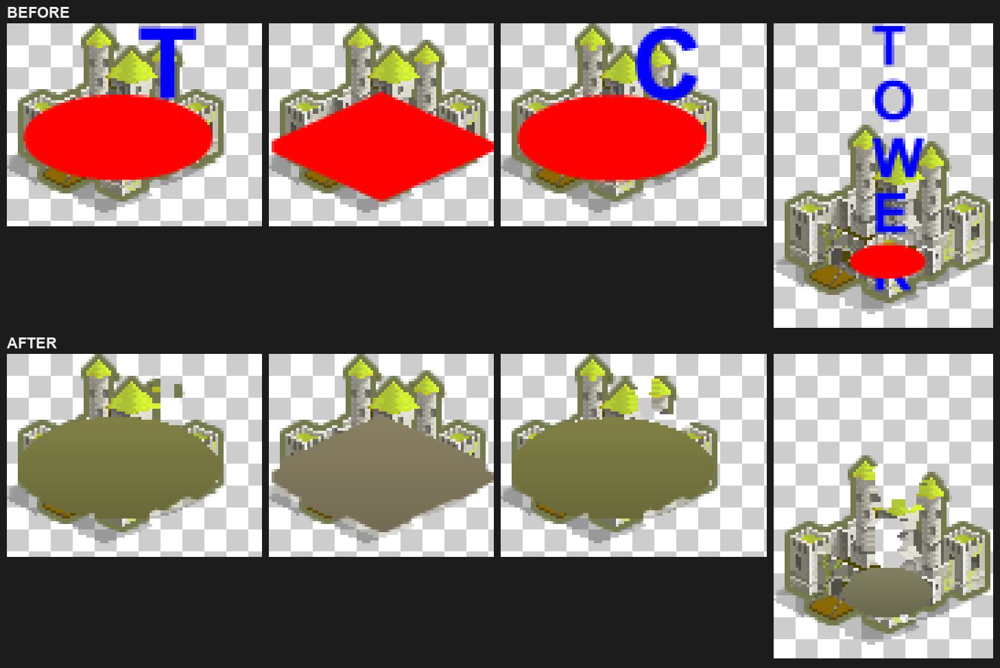
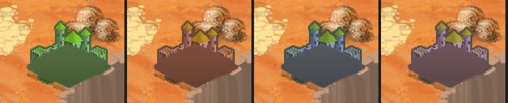
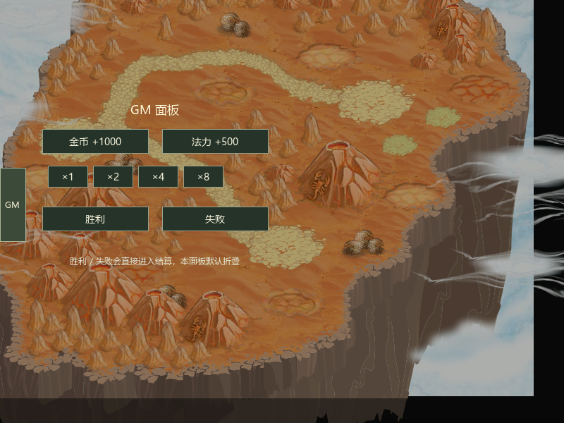
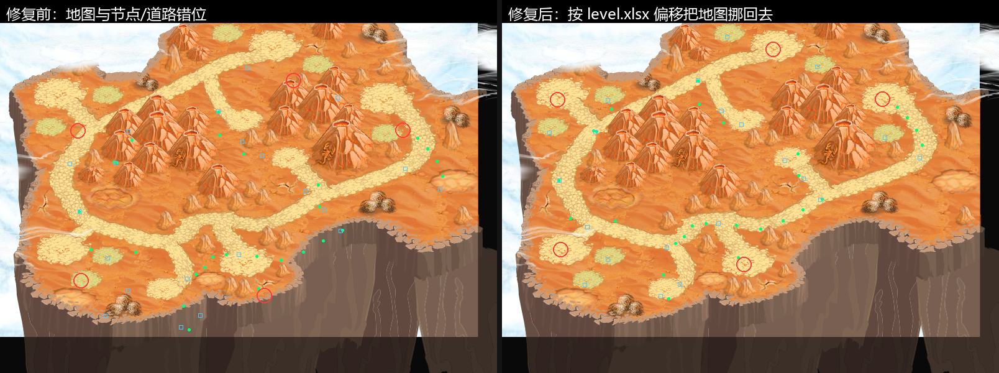
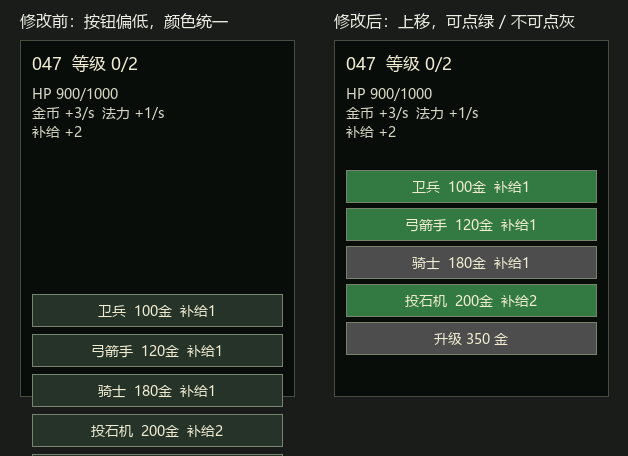
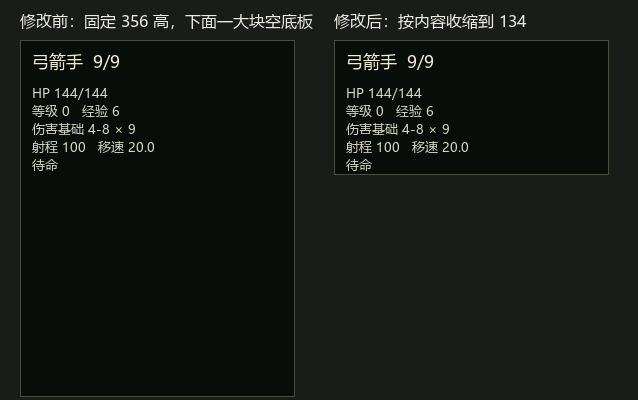
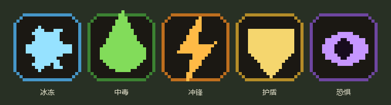
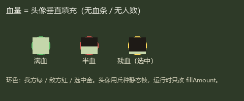
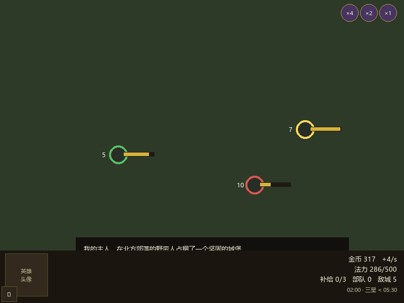

# 城邦争霸首章复刻（Windows x64）

## 范围

- 原版：4399《城邦争霸》正式版 1.0.4。
- 关卡：L1-L8，不包含 L99 教学关。
- 系统：经济、补给、招募、升级、附属建筑、寻路、驻军、远程战斗、特技、四族法术、AI、占领和胜负。
- 局外：简单关卡选择、L1-L8 解锁、最佳星级/时间、本地自动存档。
- 不包含：教令、第二/三章、标题动画、设置、成就大厅和联网。

## 当前实现

- `BattleSimulation` 使用 30 Hz 固定步进，接收统一 `BattleCommand`，输出 `BattleSnapshot` 和 `BattleEvent`。
- 战斗使用原版阵营索引，支持 L4、L5、L7 的双 AI 玩家；每个 AI 独立维护资源、修正器、部队和施法冷却。
- 部队由逐单位状态组成，包含独立位置、HP、攻击计时、目标、士气、经验、冰冻、毒、冲锋和弹道。
- 1.0.4 首章敌方逐关修正器已经接回；玩家应用原版基础教令第一档，完整教令界面与跨章成长仍不在范围内。
- 15 类首章特技已覆盖冲锋、长枪、盾墙、毒、冰冻、溅射、攻城、恐吓、神圣光环、恐怖冲刺、纪律、机械和不朽免疫规则。
- 四族 16 个法术按原版 ID 和效果类别执行，包含单次攻击、0.5 秒旗帜脉冲、召唤、转化、恐惧和终极技能条件。
- 道路用 `Level1-8GraphMarkersClass` 恢复的 303 个中间 waypoint 进行带权寻路。
- 操作：左键按住部队拖动下令，左键单击建筑/空地选中，单击空地取消选择；原版没有框选多选，对应的拖框逻辑已删除；右键不再用于战斗命令。
- `TakeoverUIWindow` 提供关卡选择、战斗 HUD、建造/招募、法术目标选择和胜负结算。
- 战役进度写入 `Application.persistentDataPath/takeover-campaign.json`，采用临时文件、备份和损坏回退。
- 原版 1.0.4 已实际导入 45 个兵种的三帧循环、7 类建筑的四阵营外观、8 张地图、78 个音频、14 个字体和 765 张原始图片。
- 地图 Sprite 的完整导出边界先居中裁切为原版 `BitmapData` 的 800×600 舞台，再叠加节点；模拟坐标、地图像素坐标和 Unity 显示坐标分别转换，保留 Flash 的 Y 轴方向。

## 原版资源结果

- SWF：20,934,803 字节，SHA-256 `b9640da8118cf924d87a759834a39197db62c3273b4aeeef4eb5f990d37a1463`。
- FFDec 26.4.0 导出 1,437 个 ActionScript、765 张图片、23,074 个精灵帧、78 个声音、14 个字体和 SymbolClass 映射。
- 原版素材已通过 YooAsset 的 Actor、Scenes、Audios、Fonts、UIRaw 收集器导入，Play Mode 中地图、单位、建筑、字体和音乐 location 均有效。
- 当前单位动画采用每个兵种三段代表性 `Go` 帧循环；完整攻击/待机/死亡时间线仍可按反编译 Sprite 时间线继续细化。

## 外部 Windows 构建

本机按约定没有安装 Unity Windows Build Support。以下工作仍需在已有该模块的 Windows/CI 环境执行：

- Luban 重新生成到 Windows 构建缓存。
- Unity Windows x64 Player 构建、符号归档和 Windows 真机验收。
- 用 Windows 成品逐关对照原版反编译行为，校正视觉动画帧和不可自动断言的时序细节。

外部流程见 `Tools/TakeoverPipeline/README.md`。

## 验证

Unity 编辑器中执行 `TEngine/Takeover/运行首章规则校验`，或批处理：

```powershell
Unity.exe -batchmode -nographics -quit `
  -projectPath <repo>\UnityProject `
  -executeMethod TakeoverValidation.RunBatch
```

校验覆盖配置行数、L1-L8 节点和道路 waypoint、八关初始化、多 AI 玩家、收入边界、逐单位战斗、占领、特技解析、16 个法术入口、敌方修正器，以及 `TakeoverUIWindow` / `TakeoverUIActionButton` 预制体文案中残留的问号占位符。

本机已验证：

- Unity 全量脚本编译：通过，无 `error CS`。
- 首章规则校验：PASS。
- Play Mode 冒烟：主场景、热更入口、`TakeoverUIWindow`、L1 启动和模拟推进均通过。
- 原版资源冒烟：地图图集、兵种动画、建筑外观、原版字体与 WAV 音乐均成功加载，无缺失 location。
- 提示消息使用独立深色浮层、粗体文字、阴影和描边；HUD 背景不接收鼠标事件，不遮挡地图操作。
- L1-L8 固定种子压力扫描：八关均完成初始化并运行到终局或 900 秒上限，无异常；该脚本玩家只用于发现死锁和异常，不代表玩家真实通关能力。

## UI 文案问号占位符修复

预制体原先由非 UTF-8 的文本通道写入，`TakeoverUIWindow.prefab` 与 `TakeoverUIActionButton.prefab` 里的中文全部退化成了 `?`（运行时由 C# 赋值的文案正常，所以表现为“部分中文正常、静态文案全是问号”）。已按节点路径逐条改回中文：

| 节点 | 修复后文案 |
|------|-----------|
| `LevelSelect/ChapterPanel/Title` | 第一章 · 西利亚公国 |
| `LevelSelect/ChapterPanel/Hint` | 点击关卡开始 · 通关后解锁下一关 |
| `LevelSelect/ChapterPanel/ResetSave/Label` | 清除进度 |
| `BattleHUD/Controls` 下的 Pause / Restart / Levels | 暂停 / 重开 / 关卡 |
| `BattleHUD/GmControls` 下的 GmGold / GmMana | 金币 +1000 / 法力 +500 |
| `BattleHUD/GmControls` 下的 GmSpeed1、2、4、8 | ×1 / ×2 / ×4 / ×8 |
| `Result/ResultPanel` 下的 Replay / Next / Menu | 再来一局 / 下一关 / 选关 |
| `TakeoverUIActionButton/Label` | 选项 |

`TakeoverValidation` 新增了预制体文案检查，任何 Text 里再出现 `?` 都会让校验失败。本次改动为预制体文案与校验脚本，尚未在 Unity 编辑器内复验表现（本机没有 Unity 编辑器与 Windows Build Support），需要在编辑器 Play Mode 或真机确认渲染。

## 建筑贴图的红色底座与蓝色字母

`NodeTown / NodeCastle / NodeCamp / NodeMageTower` 四个 SWF 符号的第 0 帧里，除了建筑本体还有两块“作者态”元素被 FFDec 一起烤进了位图：

- 一块纯红 `#FF0000` 的底座/旗帜占位图（原版运行时由脚本染色）；
- 蓝色 `#0000FF` 的类型字母（`T` / `C` / `TOWE`）。

因此 `takeover_building_1..4_{green,red,blue,purple}` 在游戏里会显示成“建筑正面压着一块大红板 + 几个蓝字母”。注意四个阵营变体的红板位置、像素数完全一致（约 1600 像素），说明它不是阵营色，而是未染色的占位色。

处理方式见 [`clean_building_baseplates.py`](../Tools/TakeoverPipeline/clean_building_baseplates.py)：

- 红色底座（含 3px 抗锯齿描边）→ 用该贴图外圈干净像素的中值色平涂并加轻微明暗渐变；
- 蓝色字母（含 2px 描边）→ 同行左右最近干净像素填色，左右都够不到（悬空）则挖成透明；
- 只处理 `takeover_building_1..4` 的 20 张主贴图；`_f0/_f1/_f2` 帧代码未使用，保持原样；`5..7`（农场/矿/方尖碑）本身没有底座，未改动。



**注意这是 retouch 而不是还原**：底座是不透明地盖在建筑本体上的，导出的 PNG 里底座下面没有像素，所以那块区域看起来是一段实心墙体，而不是原版的建筑内部。要做到完全还原，只能用原始 SWF 重新挑帧（隐藏底座/字母的帧）再跑管线。

## 建筑贴图配置到 building.xlsx（默认底图 + 阵营染色）

建筑贴图不再由代码拼名字（原来拼 `takeover_building_{id}_{green|red|blue|purple}`，缺失时再回退到 `takeover_building_{id}`、`takeover_building_town/castle/...`）。现在：

- `Configs/GameConfig/Datas/building.xlsx` 追加一列 `sprite`（`string`，分组 `c`），存建筑默认贴图的 location（YooAsset 地址 = 文件名，不带扩展名）；
- 代码只读表：`TakeoverVisualCatalog.BuildingLocation(id) => Cfg.BuildingById(id)?.Sprite`；
- 四个阵营共用这一张底图，**国家差异靠颜色叠加**：`TakeoverRunner.FactionTint(node)` 用 `Color.Lerp(Color.white, NodeColor(node), FactionTintBlend)` 给 `SpriteRenderer.color` 染色，`FactionTintBlend = 0.55f`（0 = 原图，1 = 纯阵营色）。

| id | 建筑 | sprite |
|---|---|---|
| 1 | 城镇 TOWN | `takeover_building_1` |
| 2 | 要塞 CASTLE | `takeover_building_2` |
| 3 | 营地 CAMP | `takeover_building_3` |
| 4 | 魔法塔 MAGIC TOWER | `takeover_building_4` |
| 5 | 农场 FARM | `takeover_building_5` |
| 6 | 矿场 MINE | `takeover_building_6` |
| 7 | 英雄碑 OBELISK | `takeover_building_7` |

列留空 = 该建筑不显示贴图，`TakeoverSelfCheck` 会把它判为校验失败。仓库里原有的 `takeover_building_{id}_{color}.png`（4 套阵营图）保留作素材，代码已不再引用。

同一张 `takeover_building_2`（要塞）在 `FactionTintBlend = 0.55` 下的四种阵营观感（西利亚 / 卡若米森 / 艾斯得雷 / 瑞维迪斯）：



染色走 `SpriteRenderer.color` 的乘法叠色，会连带压暗；强度固定在 `TakeoverRunner.FactionTintBlend`（0 = 原图，1 = 纯阵营色）。以后若觉得偏暗，可以改成按通道混合，或换成半透明色块叠加。

**导表**：只导数据，不生成代码。

```powershell
Configs\GameConfig\gen_data_only.bat
```

- 该脚本用 `dotnet Luban.dll -t client -d bin --conf luban.conf`，把 `*.bytes` 直接写回 `UnityProject/Assets/AssetRaw/Configs/bytes/`；
- 仓库 `Tools/Luban/` 被 `.gitignore` 忽略，需要自备一份 Luban（或设 `LUBAN_DLL` 环境变量）；本机用的是同机另一项目的 Luban 1.0.0，其编译目标是 net7，脚本里已设 `DOTNET_ROLL_FORWARD=Major` 以便在 .NET 10 上运行；
- 生成代码模板与仓库现有代码**不同版**（新版会写扁平文件名 `takeover.Building.cs`、列表长度加 `Min(_buf.ReadSize(), _buf.Size)`），因此**刻意不跑** `gen_code_bin_to_project.bat`；`GameConfig/takeover/Building.cs` 只按表结构追加了 `Sprite` 字段与读取行。以后若要整体重导代码，需要先决定是否接受模板升级。

## 拖拽下令预览曲线的起点修复

`TakeoverRunner.UpdateOrderPreview(from, to, attack)` 内部已经做了 `DisplayPosition`（逻辑坐标 → 显示坐标）转换，但 `HandleInput` 的两处调用又先把 `_dragSquad.Pos` 转了一次，等于起点被转换两次。

`LogicalToDisplay(y) = 600 - y/2`，二次转换后 `y'' = 300 + y/4`，偏差 `y'' - y = 0.75y - 300`：除了 `y = 400` 这个不动点，其余位置起点都会偏移（逻辑 y 越小偏得越多，最大约 300 逻辑单位），所以曲线经常从地图上某个莫名其妙的位置画出来。目标点的传参（节点 `Pos` 或 `MouseWorldPosition()`）本来就是逻辑坐标，只有一次转换，因此端点是对的。

修复：两处调用改为传 `_dragSquad.Pos`（逻辑坐标），并在方法上注明参数是逻辑坐标。

## 检查器按钮闪烁修复

`TakeoverUIWindow.RefreshInspector` 原先把“金币/补给的整数值”也算进刷新键，而收入按逻辑秒入账（`BattleSim.TickLogicalSecond`），于是每秒（`×4`/`×8` 速度下更频繁）都会 `ClearChildren` + 重新 `Instantiate` 检查器里的招募/升级按钮；`Object.Destroy` 要到帧末才生效，新旧按钮同帧共存，看起来就是那两个按钮一直在闪，同时每帧还产生一遍 GC。

现在把“结构”和“状态”分开：

- 按钮计划（名字、文案、位置、点击、可用条件）每次状态变化重建到 `_inspectorPlan` / `_spellPlan`，用 `BuildPlanSignature` 生成结构签名；
- 只有签名变化（换目标、建筑等级变化、可招募列表变化）才销毁重建按钮，否则只调用 `ApplyRules` 刷新 `interactable`（`Selectable.interactable` 赋值相同时直接返回，不会触发重绘）；
- `ClearChildren` 在 `Object.Destroy` 前先 `SetActive(false)`，避免重建帧出现新旧按钮重叠；
- 法术栏同样处理，法力/终极充能的连续变化不再重建按钮。

以上为纯逻辑改动，需在 Unity Play Mode 中确认（本机无法运行编辑器）。

## 提示条背景自适应

预制体里 `ToastPanel` 是固定 `700×52` 的深色底（`Image` 颜色 `rgba(0.02,0.025,0.02,0.88)`），短提示（如“选中 057，等级 0”）会把整条 700 宽的底色铺在屏幕下方，横向压住左下角 GM 按钮和底部操作栏。

修复在 `TakeoverUIWindow.FitToastToText()`（`ShowToast` 里调用）：

- 先按“不换行”量 `_toast.preferredWidth`，面板宽度 = `clamp(文字宽 + 40, 220, 700)`；
- 只有文字超过 700 才切回 `HorizontalWrapMode.Wrap`，并按最终宽度重算高度 `clamp(文字高 + 14, 34, 120)`；
- 面板 pivot 是 `(0.5, 0)`、锚点在底部中间，所以缩放只影响自身，不会跑位。

预制体的默认 `700×52` 保留（编辑器里预览用），运行时每次显示提示都会按文字重算。

## GM 面板（可折叠）

原来左下角那条 250×66 的 `BattleHUD/GmControls` 工具条改成可折叠的 GM 面板：

- **折叠/展开按钮**：`TakeoverUIWindow.BuildGmPanel()` 运行时创建，挂在 `BattleHUD` 下、锚点 `(0, 0.5)`，尺寸 36×104，标签 `GM`，始终位于 HUD 最上层；
- **面板**：复用原 `GmControls` 节点，展开时 `anchorMin=(0,0)`、`anchorMax=(0.5,1)`，即**占左半个屏幕**；背景**完全透明**（`Image.color` alpha 0）且 `raycastTarget=false`，所以只有按钮和文字可见，空白处照常能点地图；`SetAsLastSibling()` 让它画在所有 HUD 元素之上；
- **默认折叠**：`BuildGmPanel()` 结束与每次 `ShowBattle()`（进关卡/重开）都会 `SetGmExpanded(false)`；
- **内容**：标题「GM 面板」、`金币 +1000`、`法力 +500`、`×1/×2/×4/×8` 调速、**胜利**、**失败**，以及一行说明。位置常量集中在 `BuildGmPanel()`（画布参考 800×600）。

新增的两个 GM 按钮走 `TakeoverRunner.GmEndBattle(bool victory)`：直接置 `State.IsOver/HumanVictory`，复用 `Update` 里既有的 `IsOver` 结算分支——「胜利」按当前用时算星并调用 `Campaign.Complete`（解锁下一关），「失败」只出战败结算、不解锁。

面板是运行时搭的（没有改 `TakeoverUIWindow.prefab`），因为新增/重排那么多 UGUI 节点手写预制体 YAML 风险高且本机无 Unity 可验证；后续若要在 Inspector 里拖布局，可以再把这块迁进预制体。

布局示意（画布参考 800×600；面板背景透明，按钮和文字直接浮在地图上，面板本身画在所有 HUD 之上）：



## 地图贴图与舞台坐标的对齐

`takeover_map_{level}.png` 是从 FFDec 导出的 `Level{N}GraphMarkersClass` 帧位图里**居中裁切**出 800×600 的（`import_chapter_assets.py` 的 `crop_rgba_png`），而节点/道路用的是舞台坐标，两者的差值在每张图上都不一样（裁切偏移 L1 是 `246,145`、L8 是 `93,83`），于是建筑看起来“压不到地形上”。

修正量是拟合出来的，不是猜的：`OriginalMapWaypoints` 里有 300+ 个道路 waypoint（舞台坐标，`y` 存的是模拟坐标所以要 `/2` 才是像素），把它们和图上画出来的沙土路对齐，用距离变换搜索平移量，使 waypoint 到最近路面像素的平均距离最小。结果（L3 为例残差 1.9px，L8 本来就是 0）：

| 关卡 | 1 | 2 | 3 | 4 | 5 | 6 | 7 | 8 |
|---|---|---|---|---|---|---|---|---|
| offset x | -46 | -55 | -36 | -22 | -57 | -9 | +3 | 0 |
| offset y | -40 | -42 | -50 | -23 | -65 | -50 | -78 | 0 |

存储与使用：

- `level.xlsx` 新增 `map_offset_x` / `map_offset_y`（`int`、分组 `c`），按 `asset_id` 1..8 填写，其余关卡为 0；
- `TakeoverVisualCatalog.MapOffset(levelAssetId)` 读表返回 `(MapOffsetX, MapOffsetY)`；
- `TakeoverRunner.BuildMapBackground()` 把地图渲染器摆到 `(400 - offset.x, 300 + offset.y)`——因为贴图特征在像素 `(x+ox, y+oy)`，而世界坐标 `y = 600 - y_pixel`，所以 x 取反、y 同号；
- 节点、道路线、迷雾等仍然直接用舞台坐标，不动。



绿点是道路 waypoint，红圈是建筑节点：修复前（左）明显整体偏右下，修复后（右）压在沙土路和空地上。

## 检查器动作按钮（上移 + 可点击状态配色）

原来的招募/建造/升级按钮是从 `Inspector/Actions` 容器的**中心**往下排（第一个在 `-34`，间距 40），实际落点比正文低了约 140px，5 个按钮会垂到面板外面压住地图。

现在改成从容器顶部往下排：`InspectorActionTopY = 90f`、`InspectorActionSpacing = 38f`（[TakeoverUIWindow.cs](UnityProject/Assets/GameScripts/HotFix/GameLogic/Takeover/TakeoverUIWindow.cs) 顶部常量），第一个按钮紧贴正文下方，5 个按钮仍落在 220 高的 `Actions` 容器内。

配色走 `Selectable` 的 ColorTint：

- 可点击：正常 `rgba(0.20,0.48,0.26)`（绿）、悬停更亮、按下更深；
- 不可点击：`rgba(0.30,0.30,0.30)`（灰）。

实现是 `ApplyActionStateColors(button)` 设置 `button.colors`（ColorBlock），只对检查器按钮生效（`InstantiateActionButton(..., stateTint: true)`），法术栏和 GM 按钮保持原样。`ApplyRules` 只改 `interactable`，颜色由状态机自动跟随。

**踩过的坑**：`ColorTint` 不是直接给按钮上色，而是把状态色写进 `CanvasRenderer` 的颜色，再和 `Image.color` 相乘。按钮模板底图是深色 `rgba(0.15,0.2,0.16,0.84)`，直接叠绿色会变成墨绿（实机第一版就是这样）。现在 `ApplyActionStateColors` 会把 `targetGraphic.color` 刷成白色，状态色才是最终显示色；并且在 `SetActive(true)` 之前套好配色，避免首帧闪一下模板默认色。



面板高度也改成按内容收缩（`InspectorInfoOnlyHeight = 134f`；有按钮时 `InspectorActionBaseHeight = 174f + (按钮数-1) × 38`）：选中部队时只有标题+正文，不再留整块 356 高的空底板；选中自己的城堡/空地时随按钮数量增高。面板锚点在右上、pivot 也是 `(1,1)`，高度变化只影响底部边缘。



## 取消框选多选

原版《城邦争霸》没有框选：左键按住部队拖动下令、左键单击建筑或空地选中、单击空地取消选择。旧实现里的“空地拖框 → 绿色选择框 → 框内部队全选”整套逻辑已删除：

- 删掉 `SelectionBox` 的 LineRenderer 与 `UpdateSelectionBox` / `SelectSquadsInBox` / `ScreenRect` / `ScreenToDisplayWorld`；
- 删掉 `_selectedSquads` 集合和 `SelectedSquads` 属性，只保留单支 `_selectedSquad`；
- `IssueGroupOrderAtMouse` 简化为 `IssueOrderAtMouse(Squad)`，一次只命令被拖动的那支部队；
- 关卡开场提示里“拖框可多选”等文案一并去掉。

鼠标判定现在只用按下点 `_pressScreen` 做 8px 阈值：超过阈值算拖动下令，否则按单击处理。

## 兵种头顶 UI 与战斗 HUD（预制体驱动）

两块 UI 都做成了预制体，运行时只 `Find` 节点 + 赋值，不再用 `new GameObject` 现搭：

- `TakeoverUIWindow.prefab` 内的 `BattleHUD/SquadBadgeLayer/SquadBadgePrototype`（隐藏的原型节点），子节点顺序即绘制顺序：`Ring` 36×36（阵营色环）→ `HpFill` 34×34（**头像背后的血量填充**，`Image` = Filled / Vertical / Bottom）→ `Portrait` 30×30（兵种头像，普通 Image，不参与填充）→ `StatusFrozen/Poison/Charge/Shield/Fear` 14×14（右上角状态小图标，sprite 直接以 GUID 引用在 prefab 里，默认隐藏）。不画血条、不显示人数。运行时 `Instantiate` 这个节点当每支 squad 的徽标。
- `BattleHUD` 下新增 `SquadBadgeLayer`（铺满、无 Image）、`BottomBar`（800×104 底栏）和 `SpeedControls`（右上角 124×38，原版调速按钮位置）。底栏内：`PortraitFrame` 84×84 贴左、`Settings` 30×30 左下角、`Top`（资源 + 时钟）右对齐到底栏右下；`Inspector` 下移到 `-56`，不再压住右上角按钮。

> 徽标原型一开始做成了独立 `TakeoverSquadBadge.prefab` + `LoadGameObject("TakeoverSquadBadge")`，实机不显示——新增资源不在已构建的 YooAsset 清单里时 `LoadGameObject` 会静默失败。现在改成把原型**内嵌在已经有地址的 HUD 预制体里**，运行时只 `Instantiate`，彻底不依赖新资源的清单条目。

代码侧：

- `TakeoverRunner.SyncSquadBadges()` 每帧给每支存活 squad 复用/创建徽标：`WorldToScreenPoint(squad.Pos + 34px)` → `ScreenPointToLocalPointInRectangle` 换算成画布坐标，所以徽标尺寸不随镜头缩放（与原版一致）；血量写 `HpFill.fillAmount`（头像背后从下往上填充，绿/黄/红按 60%/30% 换色），头像本身始终完整；右上角最多 3 个状态图标（冰冻 > 中毒 > 冲锋 > 护盾 > 恐惧）；环色区分我方绿、敌方红、选中金并放大 1.12 倍；squad 阵亡或换关时回收。
- `TakeoverUIWindow` 绑定底栏与右上角按钮：资源/时钟走 `BottomBar/Top/*`，`Settings` 打开 GM 面板，`SpeedControls/Speed1|2|4` 调 `SetSpeed` 并在 `RefreshHud` 里高亮当前档位（`×2*`）。
- `TakeoverValidation.CheckUiPrefabStructure` 校验两个预制体的必需节点/组件，缺了直接报 FAIL。

> **踩过的坑（头顶 UI 不显示）**：TEngine 的 `UIRoot/UICanvas` 是 **Screen Space - Camera**（`UIRoot.prefab` 里 `m_RenderMode: 1`，带 `UICamera`、`m_PlaneDistance: 100`），窗口 prefab 的 Canvas 只是嵌套 Canvas。给 `ScreenPointToLocalPointInRectangle` 传 `null` 相机会按 Overlay 计算，徽标被推到画布外、看起来就是“没显示”。现在取 `canvas.rootCanvas`，非 Overlay 时传 `rootCanvas.worldCamera`。
> 尺寸也要换算：UICanvas 的 CanvasScaler 参考分辨率是 **750×1334**（`MatchWidthOrHeight = 0`），舞台是 800×600，所以徽标按 `每舞台像素的屏幕像素 / rootCanvas.scaleFactor` 缩放，才和兵种保持相对大小。首次同步会打一条 `[Takeover] 头顶 UI: squads=… renderMode=… badgeScale=…` 便于确认。

素材说明：HUD 的底栏/按钮框在原版里是 SWF 矢量绘制，当前提取物（`takeover_raw_*`）没有这些图，所以先用**纯色块 + 现有素材**搭结构：徽标头像取该兵种静态帧 `takeover_unit_{id}_{slug}`，底栏/按钮用 `Image` 纯色（原版配色）。等拿到原版 HUD 元件（FFDec 重新导出）后，只需替换对应 `Image.sprite`，结构与代码不动。

**操作也改到徽标上**：`PickHumanSquadByBadge` 用 `RectTransformUtility.RectangleContainsScreenPoint` 命中徽标矩形，命中才算选中/开始拖动下令；点士兵本体不再响应。徽标矩形的相机同样取 `rootCanvas.worldCamera`。

状态图标是自绘的占位美术（24×24，`Assets/AssetRaw/UI/Icons/takeover_status_*.png`），sprite 以 GUID 直接引用在 `TakeoverUIWindow.prefab` 的 5 个 `Status*` 节点上——不走运行时按地址加载（新增资源不在已构建的 YooAsset 清单里时 `SetSprite` 会静默失败，第一批图标就是这么丢的）。代码只负责显示/隐藏并按 `(13 - 15×i, 15)` 排列前 3 个。`TakeoverValidation` 里有数量校验；换原版图标时替换同名 PNG 即可，GUID 不变。







Windows x64 成品尚需在外部构建环境执行，见 `Tools/TakeoverPipeline/README.md`。
